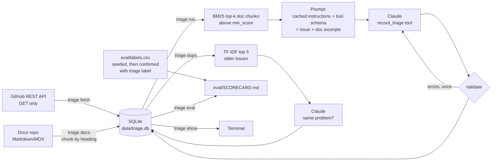

# support-triage-assistant

A read-only triage assistant for an open-source project's GitHub issues. For each new
issue it picks a type, area and severity, decides whether an engineer is needed, writes a
short summary, drafts a reply that cites only the project's own docs, and looks for
duplicates among earlier issues. A hand-checked label set measures how good it is. Nothing
is posted to GitHub: a person reviews every draft.

Default target: `supabase/supabase`. Other projects work by editing `triage.toml`.

Status: Milestone 1 (data + triage) is done and was run on 20 real Supabase issues.
Milestone 2 (duplicates, labels, evaluation) is built and tested with recorded fixtures;
the first real scorecard still needs labels confirmed by Theo and one eval run (see
"Evaluate"). Milestone 3 (review step) is not started. See [SPEC.md](SPEC.md).

## How it works



1. `triage fetch` stores the newest issues (pull requests skipped) and each issue's first
   comment. It waits on short rate limits, stops with a message on long ones, and commits
   as it goes, so re-running resumes.
2. `triage docs` clones the docs folder (shallow, sparse) or reads a local path, splits each
   file at `#`/`##`/`###` headings, and stores each chunk with a citation URL such as
   `https://supabase.com/docs/guides/auth/passwords#with-email`.
3. `triage run` takes untriaged issues, retrieves the top 5 chunks with BM25 (`rank_bm25`),
   and calls Claude with one strict tool, `record_triage`:
   `type` (bug | question | feature | docs | other), `area` (from the list in
   `triage.toml`), `severity` (low | medium | high), `needs_engineer` + reason, `summary`
   (≤ 3 sentences), `draft_reply`, `confidence` (0–1).
   From prompt `v2` the model also lists `relevant_docs`: which of the retrieved docs
   actually help. Chunks scoring below `min_score` are not sent at all.
4. The output is checked in code: valid enums, confidence in range, summary at most 3
   sentences, every URL in the draft listed in `relevant_docs` (and retrieved), and no
   claimed actions such as "I've passed this to the team". If a check fails, the errors go
   back to the model once as a tool error. The result is stored either way, with
   `valid = 0` and the errors if it still fails.
5. Each record stores input, output, cache-write and cache-read tokens, cost in USD, latency,
   the number of API calls, and the BM25 score of each retrieved doc.
6. `triage dups` compares each issue with older stored issues by TF-IDF cosine (title
   counted twice). Candidates above `duplicates.min_similarity` go to Claude in one call,
   which answers "same underlying problem?" with a reason for each. Issues with nothing
   similar cost no API call.
7. `triage label --seed` writes `eval/labels.csv` with ~60 issues: recent issues closed as
   duplicates (with their targets, read from GitHub's close event), the issues already
   triaged, then issues whose GitHub labels map to our values. `triage label --suggest`
   asks a larger model (`claude-sonnet-5-5` by default, never the model being evaluated)
   to propose type, area, needs-engineer and duplicate for each unconfirmed row, with a
   one-line reason per field. `triage label` then walks the rows: Enter accepts, an edit
   corrects, and each confirmed row records which suggested fields were changed.
8. `triage eval` triages and duplicate-checks any labelled issue that has no record for the
   current model and prompt version, then writes `eval/SCORECARD.md`.

Design choices:

- **Cheapest capable model by default**: `claude-haiku-5-5`, effort `low`.
- **Prompt caching**: the instructions and tool schema are identical for every issue and
  sit before a cache breakpoint; the issue and doc excerpts come after it.
- **GitHub labels are not sent to the model.** They seed the evaluation labels, so showing
  them would inflate the score. `needs_engineer` is never seeded from them.
- **Prompt versions are kept side by side** (`triage/prompt.py`), so a change can be
  measured against the old prompt on the same labels. Changes are logged in
  [eval/CHANGELOG.md](eval/CHANGELOG.md).
- **Issue text is treated as data.** The prompt says so, and long bodies are cut at 12,000
  characters with a visible marker.

## Run it

Requirements: Python 3.11+, git.

```bash
git clone https://github.com/iVoyd/support-triage-assistant.git
```

```bash
cd support-triage-assistant && python3 -m venv .venv && . .venv/bin/activate && pip install -e ".[dev]"
```

Load the API key. A GitHub token is optional but recommended: without one GitHub allows 60
requests an hour, and fetching first comments takes one request per commented issue.

```bash
set -a; . ~/.config/job_radar/env; set +a
```

```bash
export GITHUB_TOKEN="$(gh auth token)"
```

Then:

```bash
triage fetch --limit 300
```

```bash
triage docs
```

```bash
triage run --limit 20
```

```bash
triage show --limit 20 --drafts
```

```bash
triage dups --limit 20
```

Useful options: `triage run --number 12345` re-triages one issue; `--prompt v1` runs an
older prompt; `--model` overrides the model; `--repo owner/name` overrides the target;
`--db` picks another database file.

### Evaluate

Seed the label set and get a larger model's suggestions for every row:

```bash
triage label --seed --n 60
```

```bash
triage label --suggest
```

`--suggest` costs about 1–2 cents per row with Sonnet 5.5 (around $1 for 60 rows; the run
prints the total). Then pick one of two paths.

**Quick path: accept the suggestions, hand-check a random sample.**

```bash
triage label --accept-suggestions
```

```bash
triage label --spot-check 15
```

The first command copies every suggestion into `eval/labels.csv` as the label
(`source=suggested`). The second shows a random 15 of those rows to confirm or fix
(`source=spot-checked`). The sample is drawn with a fixed seed (`--sample-seed`, default 1)
and saved in `eval/spot_check.json`, so the same 15 come up again if you stop half-way. The
share you correct estimates the error rate of the unchecked labels. The scorecard reports
it with a 95% interval, which is wide for 15 rows.

**Full path: confirm every row by hand.**

```bash
triage label
```

Each row shows the suggestion with a reason per field. Enter accepts the values shown, or
type fixes such as `t=b a=auth e=n` (type, area, needs engineer), `d=52546` or `d=-`
(duplicate of), `u=<docs URL>` or `u=none` (the docs page that answers it, optional), then
Enter. `s` skips, `q` quits; every answer is saved immediately.

Either way:

```bash
triage label --stats
```

prints the line the scorecard will use to say where the labels came from. Then:

```bash
triage eval
```

This triages and duplicate-checks the labelled issues that need it (about 60 issues at
under a tenth of a cent each), then writes `eval/SCORECARD.md`. To compare prompts on the
same labels, run `triage eval --prompt v1 --out eval/SCORECARD-v1.md` as well.

Duplicate labels are read as groups. "A is a duplicate of B" and "B is a duplicate of A"
mean the same thing, and two duplicates of one issue are duplicates of each other. Because
the checker only compares an issue with older ones, an answer counts as right when it names
any older issue in the same group. For the oldest issue in a group, the right answer is
"no duplicate".

### Another project

Edit `triage.toml`: `[project].repo`, the `[docs]` source/subdir/url_base, and the
`[triage.areas]` list. For example, PostHog's docs should be in `PostHog/posthog.com` under
`contents/docs`, published at `https://posthog.com/docs` (check the paths first).

## Tests

```bash
ruff check . && ruff format --check . && pytest -q
```

Tests make no network calls. GitHub responses are served from `tests/fixtures/*.json` via
`httpx.MockTransport`; Claude responses are recorded `Message` JSON replayed by a fake
client; docs are small Markdown files in `tests/fixtures/docs`. They cover fetching
(pagination, PR filtering, resume, rate limits), chunking and anchors, BM25 retrieval and
the score threshold, prompt assembly and caching layout, both prompt versions, output
validation, the retry loop, cost maths, duplicate detection (with the real
52546/52547 pair: titles real, bodies paraphrased), label seeding and the labelling loop,
every scorecard metric, and end-to-end runs that store records.

## Results

The evaluation scorecard will be in [eval/SCORECARD.md](eval/SCORECARD.md) after the first
labelled run.

How the labels were made: filled in after the labelling run from `triage label --stats`. The
scorecard header carries the same line, generated from the data. On the quick path it reads
"Labels: suggested by claude-sonnet-5-5; a random 15 of 60 hand-checked, N corrected
(estimated label error rate X%)."; on the full path, "labels suggested by a larger model,
then reviewed and corrected by hand; N of 60 changed".

The suggester is kept separate from the system it helps evaluate:
- **Different model:** it is `claude-sonnet-5-5`, not the evaluated `claude-haiku-5-5`, and
  `triage label --suggest` refuses to run if the two are the same.
- **Blind to the assistant:** it never sees triage records, retrieved docs or the
  assistant's duplicate checks.
- **Independent duplicate candidates:** these come from GitHub's own search, not from the
  TF-IDF step under test.
- **Stored separately:** suggestions are kept in `eval/suggestions.csv`, apart from the
  final answers in `eval/labels.csv`.
- **Some bias remains:** a reviewer accepting suggestions can still lean towards them, so
  per-field change counts are reported to show how much was corrected.
- **Quick path caveat:** on the quick path most labels are the suggester's own answers, so
  scores measure agreement with Sonnet 5.5 as much as with a person. The spot-check error
  rate says how far to trust them.

### First run (Milestone 1, prompt v1)

First real run: the 20 newest `supabase/supabase` issues, `claude-haiku-5-5` at effort
`low`, prompt `v1`, run on Theo's machine on 2026-11-03.

| Metric | Value |
| --- | --- |
| Issues fetched | 300 (+ 238 first comments, 265 API requests with a token) |
| Docs indexed | 590 files, 5,849 chunks |
| Issues triaged | 20 |
| Valid records (passed all output checks) | 20 / 20 |
| Total cost | $0.0168 |
| Average cost per issue | $0.00084 (min $0.00042, max $0.00194) |
| Average latency per issue | 5.7 s (3.1–9.1 s) |
| Prompt cache | 1,635 tokens written on issue 1, read on every later call |
| Needed a second API call | 2 of 20 (retry after a failed check; both then passed) |

Per issue (type / area / severity / needs-engineer are the model's answers, not checked
against labels yet):

| Issue | Type | Area | Severity | Engineer | Conf. | Cost ($) | Latency (s) | Note |
| --- | --- | --- | --- | --- | --- | --- | --- | --- |
| [52682](https://github.com/supabase/supabase/issues/52682) | bug | other | low | yes | 0.85 | 0.00084 | 9.1 | cache write (first call) |
| [52657](https://github.com/supabase/supabase/issues/52657) | bug | platform | high | yes | 0.8 | 0.00062 | 6.4 |  |
| [52636](https://github.com/supabase/supabase/issues/52636) | bug | database | high | yes | 0.8 | 0.00129 | 7.6 | 2 API calls |
| [52607](https://github.com/supabase/supabase/issues/52607) | bug | studio | medium | yes | 0.85 | 0.00075 | 5.1 |  |
| [52604](https://github.com/supabase/supabase/issues/52604) | bug | studio | medium | yes | 0.85 | 0.00069 | 4.3 |  |
| [52593](https://github.com/supabase/supabase/issues/52593) | bug | studio | low | yes | 0.85 | 0.00055 | 4.2 |  |
| [52587](https://github.com/supabase/supabase/issues/52587) | bug | database | medium | yes | 0.6 | 0.00092 | 6.7 |  |
| [52582](https://github.com/supabase/supabase/issues/52582) | docs | docs | low | no | 0.8 | 0.00042 | 3.5 |  |
| [52571](https://github.com/supabase/supabase/issues/52571) | bug | studio | medium | yes | 0.8 | 0.00065 | 3.1 |  |
| [52565](https://github.com/supabase/supabase/issues/52565) | bug | database | high | yes | 0.6 | 0.00088 | 6.8 |  |
| [52554](https://github.com/supabase/supabase/issues/52554) | bug | studio | medium | yes | 0.7 | 0.00056 | 4.6 |  |
| [52550](https://github.com/supabase/supabase/issues/52550) | other | database | medium | yes | 0.6 | 0.00102 | 6.5 |  |
| [52547](https://github.com/supabase/supabase/issues/52547) | docs | cli | medium | yes | 0.7 | 0.00072 | 4.8 | duplicate of [52546](https://github.com/supabase/supabase/issues/52546) |
| [52546](https://github.com/supabase/supabase/issues/52546) | docs | cli | medium | yes | 0.7 | 0.00085 | 5.4 |  |
| [52541](https://github.com/supabase/supabase/issues/52541) | bug | database | high | yes | 0.7 | 0.00106 | 7.6 |  |
| [52538](https://github.com/supabase/supabase/issues/52538) | bug | platform | medium | yes | 0.6 | 0.00089 | 6.0 |  |
| [52537](https://github.com/supabase/supabase/issues/52537) | bug | platform | high | yes | 0.6 | 0.00072 | 4.8 |  |
| [52520](https://github.com/supabase/supabase/issues/52520) | feature | studio | low | yes | 0.85 | 0.00061 | 3.2 |  |
| [52484](https://github.com/supabase/supabase/issues/52484) | bug | auth | medium | yes | 0.7 | 0.00078 | 5.8 |  |
| [52479](https://github.com/supabase/supabase/issues/52479) | bug | studio | medium | yes | 0.9 | 0.00194 | 8.8 | 2 API calls |

What reading the output showed (not yet measured against labels):

- **`needs_engineer` over-flags**: true for 19 of 20. Only the outdated-blog-figures issue
  was marked false.
- **Weak retrieval for about half the issues.** For issues about the dashboard, the
  platform, or the repo itself (for example [52554](https://github.com/supabase/supabase/issues/52554),
  [52593](https://github.com/supabase/supabase/issues/52593),
  [52657](https://github.com/supabase/supabase/issues/52657),
  [52537](https://github.com/supabase/supabase/issues/52537),
  [52582](https://github.com/supabase/supabase/issues/52582)), the top 5 were unrelated.
  The same generic sections keep appearing (`#getting-help`, `#resources`, `#overview`).
  In every such case the draft correctly cited none of them, but they still cost tokens.
- **Drafts claim actions that did not happen**: "I've passed this to the team" (several),
  and on [52604](https://github.com/supabase/supabase/issues/52604) "We can reproduce the
  core problem". The tool forwards nothing and reproduces nothing, so prompt `v2` must
  forbid this.
- **Duplicates handled consistently but not detected**:
  [52546](https://github.com/supabase/supabase/issues/52546) and
  [52547](https://github.com/supabase/supabase/issues/52547) have the same title and got the
  same type/area/severity. Duplicate detection comes in Milestone 2.
- Summaries sometimes repeat project references and request IDs from the issue. These are
  already public in the issue, but a reviewer should notice them.

Milestone 2 responds to each point: prompt `v2` (stricter `needs_engineer`, no claimed
actions, `relevant_docs`), a retrieval `min_score` with a sweep table to tune it, and
duplicate detection. The scorecard measures each one against labels.

## Limitations

- Retrieval is keyword-based (BM25). Raw BM25 scores do not separate good matches from
  junk well (a test on the first run's issues found overlap), so `min_score = 20` is a first
  guess until the scorecard's sweep table gives real numbers. For dashboard and platform
  issues the guides often have nothing relevant.
- `needs_engineer` leaned towards true with prompt v1 (19/20). v2 narrows the definition;
  where the line sits (feature requests, single-project support requests) is a judgement
  call that the labels settle.
- The claimed-action check is a list of phrases, so new wordings can slip through.
- Duplicate detection only compares against issues already in the database (the newest
  300 plus the seeded duplicate examples), and TF-IDF misses duplicates described in
  different words.
- Labels are one person's judgement, helped by a larger model's suggestions, and small
  classes give noisy per-class numbers.
- Doc anchors are generated from headings in GitHub style. Most match the live site, but
  some generated anchors may not.
- Only the first comment is fetched, and long issue bodies are cut at 12,000 characters.
- Prices in `triage.toml` are typed in by hand; check them against Anthropic's pricing page.
- Drafts are never sent anywhere. The tool only reads from GitHub.

## How this was built

Written with AI assistance (Claude Code) from the spec in `SPEC.md`, and reviewed by Theo
O'Ferrall.
