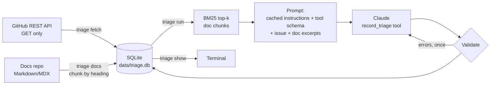

# support-triage-assistant

A read-only triage assistant for an open-source project's GitHub issues. For each new
issue it picks a type, area and severity, decides whether an engineer is needed, writes a
short summary, and drafts a reply that cites only the project's own docs. Nothing is
posted to GitHub: a person reviews every draft.

Default target: `supabase/supabase`. Other projects work by editing `triage.toml`.

Status: Milestone 1 (data + triage) is done: tested with recorded fixtures and run on 20
real Supabase issues (see "Results"). Milestones 2–3 (duplicates, eval scorecard, review
step) are not started. See [SPEC.md](SPEC.md).

## How it works



1. `triage fetch` stores the newest issues (pull requests skipped) and each issue's first
   comment. It waits on short rate limits, stops with a message on long ones, and commits
   as it goes, so re-running resumes.
2. `triage docs` clones the docs folder (shallow, sparse) or reads a local path, splits each
   file at `#`/`##`/`###` headings, and stores each chunk with a citation URL such as
   `https://supabase.com/docs/guides/auth/passwords#with-email`.
3. `triage run` takes untriaged issues, retrieves the top 5 chunks with BM25 (`rank_bm25`),
   and calls Claude with one strict tool, `record_triage`:
   `type` (bug | question | feature | docs | other), `area` (from the list in
   `triage.toml`), `severity` (low | medium | high), `needs_engineer` + reason, `summary`
   (≤ 3 sentences), `draft_reply`, `confidence` (0–1).
4. The output is checked in code: valid enums, confidence in range, summary at most 3
   sentences, and every URL in the draft must be one of the retrieved doc URLs. If a check
   fails, the errors go back to the model once as a tool error. The result is stored either
   way, with `valid = 0` and the errors if it still fails.
5. Each record stores input, output, cache-write and cache-read tokens, cost in USD, latency,
   and the number of API calls.

Design choices:

- **Cheapest capable model by default**: `claude-haiku-5-5`, effort `low`.
- **Prompt caching**: the instructions and tool schema are identical for every issue and
  sit before a cache breakpoint; the issue and doc excerpts come after it.
- **GitHub labels are not sent to the model.** They will be the ground truth for the
  Milestone 2 evaluation, so showing them would inflate the score.
- **Issue text is treated as data.** The prompt says so, and long bodies are cut at 12,000
  characters with a visible marker.

## Run it

Requirements: Python 3.11+, git.

```bash
git clone https://github.com/iVoyd/support-triage-assistant.git
```

```bash
cd support-triage-assistant && python3 -m venv .venv && . .venv/bin/activate && pip install -e ".[dev]"
```

Load the API key. A GitHub token is optional but recommended: without one GitHub allows 60
requests an hour, and fetching first comments takes one request per commented issue.

```bash
set -a; . ~/.config/job_radar/env; set +a
```

```bash
export GITHUB_TOKEN="$(gh auth token)"
```

Then:

```bash
triage fetch --limit 300
```

```bash
triage docs
```

```bash
triage run --limit 20
```

```bash
triage show --limit 20 --drafts
```

Useful options: `triage run --number 12345` re-triages one issue; `--model` overrides the
model; `--repo owner/name` overrides the target; `--db` picks another database file.

### Another project

Edit `triage.toml`: `[project].repo`, the `[docs]` source/subdir/url_base, and the
`[triage.areas]` list. For example, PostHog's docs should be in `PostHog/posthog.com` under
`contents/docs`, published at `https://posthog.com/docs` (check the paths first).

## Tests

```bash
ruff check . && ruff format --check . && pytest -q
```

Tests make no network calls. GitHub responses are served from `tests/fixtures/*.json` via
`httpx.MockTransport`; Claude responses are recorded `Message` JSON replayed by a fake
client; docs are small Markdown files in `tests/fixtures/docs`. They cover fetching
(pagination, PR filtering, resume, rate limits), chunking and anchors, BM25 retrieval,
prompt assembly and caching layout, output validation, the retry loop, cost maths, and an
end-to-end run that stores records.

## Results

First real run: 20 recent `supabase/supabase` issues, `claude-haiku-5-5` at effort `low`,
prompt `v1`, run by Theo on his own machine.

| Metric | Value |
| --- | --- |
| Issues triaged | 20 |
| Valid records (passed all output checks) | 20 / 20 |
| Average cost per issue | $0.00084 |
| Total cost (20 issues) | about $0.017 |
| Average latency per issue | 5.7 s |
| Prompt cache | `cache_read` > 0 from the second issue on |

`triage docs` indexes the current Supabase guides (590 files) into 5,849 chunks in about
3 seconds.

What the first run showed, by reading the output (not yet measured against labels):

- `needs_engineer` was true for 19 of 20 issues, which looks like over-flagging.
- Retrieval sometimes returned unrelated docs ([supabase#52554](https://github.com/supabase/supabase/issues/52554), [supabase#52582](https://github.com/supabase/supabase/issues/52582), [supabase#52537](https://github.com/supabase/supabase/issues/52537)). BM25 always returns
  its top 5, even when none of them is a good match.
- [supabase#52546](https://github.com/supabase/supabase/issues/52546) and [supabase#52547](https://github.com/supabase/supabase/issues/52547) are duplicates of each other; duplicate detection comes in Milestone 2.

These are the starting points for Milestone 2, which adds a labelled set and a scorecard
(type/area accuracy, needs-engineer agreement, retrieval hit rate, duplicate precision).

## Limitations

- Retrieval is keyword-based (BM25) with no relevance cut-off yet, so weak matches still
  reach the prompt and can be cited.
- `needs_engineer` currently leans towards true (19/20 in the first run).
- Doc anchors are generated from headings in GitHub style. Most match the live site, but
  some generated anchors may not.
- Only the first comment is fetched, and long issue bodies are cut at 12,000 characters.
- Prices in `triage.toml` are typed in by hand; check them against Anthropic's pricing page.
- Drafts are never sent anywhere. The tool only reads from GitHub.

## How this was built

Written with AI assistance (Claude Code) from the spec in `SPEC.md`, and reviewed by Theo
O'Ferrall.
