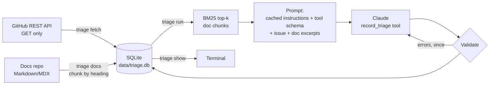

# support-triage-assistant

A read-only triage assistant for an open-source project's GitHub issues. For each new
issue it picks a type, area and severity, decides whether an engineer is needed, writes a
short summary, and drafts a reply that cites only the project's own docs. Nothing is
posted to GitHub: a person reviews every draft.

Default target: `supabase/supabase`. Other projects work by editing `triage.toml`.

Status: Milestone 1 (data + triage) is done: tested with recorded fixtures and run on 20
real Supabase issues (see "Results"). Milestones 2–3 (duplicates, eval scorecard, review
step) are not started. See [SPEC.md](SPEC.md).

## How it works



1. `triage fetch` stores the newest issues (pull requests skipped) and each issue's first
   comment. It waits on short rate limits, stops with a message on long ones, and commits
   as it goes, so re-running resumes.
2. `triage docs` clones the docs folder (shallow, sparse) or reads a local path, splits each
   file at `#`/`##`/`###` headings, and stores each chunk with a citation URL such as
   `https://supabase.com/docs/guides/auth/passwords#with-email`.
3. `triage run` takes untriaged issues, retrieves the top 5 chunks with BM25 (`rank_bm25`),
   and calls Claude with one strict tool, `record_triage`:
   `type` (bug | question | feature | docs | other), `area` (from the list in
   `triage.toml`), `severity` (low | medium | high), `needs_engineer` + reason, `summary`
   (≤ 3 sentences), `draft_reply`, `confidence` (0–1).
4. The output is checked in code: valid enums, confidence in range, summary at most 3
   sentences, and every URL in the draft must be one of the retrieved doc URLs. If a check
   fails, the errors go back to the model once as a tool error. The result is stored either
   way, with `valid = 0` and the errors if it still fails.
5. Each record stores input, output, cache-write and cache-read tokens, cost in USD, latency,
   and the number of API calls.

Design choices:

- **Cheapest capable model by default**: `claude-haiku-5-5`, effort `low`.
- **Prompt caching**: the instructions and tool schema are identical for every issue and
  sit before a cache breakpoint; the issue and doc excerpts come after it.
- **GitHub labels are not sent to the model.** They will be the ground truth for the
  Milestone 2 evaluation, so showing them would inflate the score.
- **Issue text is treated as data.** The prompt says so, and long bodies are cut at 12,000
  characters with a visible marker.

## Run it

Requirements: Python 3.11+, git.

```bash
git clone https://github.com/iVoyd/support-triage-assistant.git
```

```bash
cd support-triage-assistant && python3 -m venv .venv && . .venv/bin/activate && pip install -e ".[dev]"
```

Load the API key. A GitHub token is optional but recommended: without one GitHub allows 60
requests an hour, and fetching first comments takes one request per commented issue.

```bash
set -a; . ~/.config/job_radar/env; set +a
```

```bash
export GITHUB_TOKEN="$(gh auth token)"
```

Then:

```bash
triage fetch --limit 300
```

```bash
triage docs
```

```bash
triage run --limit 20
```

```bash
triage show --limit 20 --drafts
```

Useful options: `triage run --number 12345` re-triages one issue; `--model` overrides the
model; `--repo owner/name` overrides the target; `--db` picks another database file.

### Another project

Edit `triage.toml`: `[project].repo`, the `[docs]` source/subdir/url_base, and the
`[triage.areas]` list. For example, PostHog's docs should be in `PostHog/posthog.com` under
`contents/docs`, published at `https://posthog.com/docs` (check the paths first).

## Tests

```bash
ruff check . && ruff format --check . && pytest -q
```

Tests make no network calls. GitHub responses are served from `tests/fixtures/*.json` via
`httpx.MockTransport`; Claude responses are recorded `Message` JSON replayed by a fake
client; docs are small Markdown files in `tests/fixtures/docs`. They cover fetching
(pagination, PR filtering, resume, rate limits), chunking and anchors, BM25 retrieval,
prompt assembly and caching layout, output validation, the retry loop, cost maths, and an
end-to-end run that stores records.

## Results

First real run: the 20 newest `supabase/supabase` issues, `claude-haiku-5-5` at effort
`low`, prompt `v1`, run on Theo's machine on 2026-11-03.

| Metric | Value |
| --- | --- |
| Issues fetched | 300 (+ 238 first comments, 265 API requests with a token) |
| Docs indexed | 590 files, 5,849 chunks |
| Issues triaged | 20 |
| Valid records (passed all output checks) | 20 / 20 |
| Total cost | $0.0168 |
| Average cost per issue | $0.00084 (min $0.00042, max $0.00194) |
| Average latency per issue | 5.7 s (3.1–9.1 s) |
| Prompt cache | 1,635 tokens written on issue 1, read on every later call |
| Needed a second API call | 2 of 20 (retry after a failed check; both then passed) |

Per issue (type / area / severity / needs-engineer are the model's answers, not checked
against labels yet):

| Issue | Type | Area | Severity | Engineer | Conf. | Cost ($) | Latency (s) | Note |
| --- | --- | --- | --- | --- | --- | --- | --- | --- |
| [52682](https://github.com/supabase/supabase/issues/52682) | bug | other | low | yes | 0.85 | 0.00084 | 9.1 | cache write (first call) |
| [52657](https://github.com/supabase/supabase/issues/52657) | bug | platform | high | yes | 0.8 | 0.00062 | 6.4 |  |
| [52636](https://github.com/supabase/supabase/issues/52636) | bug | database | high | yes | 0.8 | 0.00129 | 7.6 | 2 API calls |
| [52607](https://github.com/supabase/supabase/issues/52607) | bug | studio | medium | yes | 0.85 | 0.00075 | 5.1 |  |
| [52604](https://github.com/supabase/supabase/issues/52604) | bug | studio | medium | yes | 0.85 | 0.00069 | 4.3 |  |
| [52593](https://github.com/supabase/supabase/issues/52593) | bug | studio | low | yes | 0.85 | 0.00055 | 4.2 |  |
| [52587](https://github.com/supabase/supabase/issues/52587) | bug | database | medium | yes | 0.6 | 0.00092 | 6.7 |  |
| [52582](https://github.com/supabase/supabase/issues/52582) | docs | docs | low | no | 0.8 | 0.00042 | 3.5 |  |
| [52571](https://github.com/supabase/supabase/issues/52571) | bug | studio | medium | yes | 0.8 | 0.00065 | 3.1 |  |
| [52565](https://github.com/supabase/supabase/issues/52565) | bug | database | high | yes | 0.6 | 0.00088 | 6.8 |  |
| [52554](https://github.com/supabase/supabase/issues/52554) | bug | studio | medium | yes | 0.7 | 0.00056 | 4.6 |  |
| [52550](https://github.com/supabase/supabase/issues/52550) | other | database | medium | yes | 0.6 | 0.00102 | 6.5 |  |
| [52547](https://github.com/supabase/supabase/issues/52547) | docs | cli | medium | yes | 0.7 | 0.00072 | 4.8 | duplicate of [52546](https://github.com/supabase/supabase/issues/52546) |
| [52546](https://github.com/supabase/supabase/issues/52546) | docs | cli | medium | yes | 0.7 | 0.00085 | 5.4 |  |
| [52541](https://github.com/supabase/supabase/issues/52541) | bug | database | high | yes | 0.7 | 0.00106 | 7.6 |  |
| [52538](https://github.com/supabase/supabase/issues/52538) | bug | platform | medium | yes | 0.6 | 0.00089 | 6.0 |  |
| [52537](https://github.com/supabase/supabase/issues/52537) | bug | platform | high | yes | 0.6 | 0.00072 | 4.8 |  |
| [52520](https://github.com/supabase/supabase/issues/52520) | feature | studio | low | yes | 0.85 | 0.00061 | 3.2 |  |
| [52484](https://github.com/supabase/supabase/issues/52484) | bug | auth | medium | yes | 0.7 | 0.00078 | 5.8 |  |
| [52479](https://github.com/supabase/supabase/issues/52479) | bug | studio | medium | yes | 0.9 | 0.00194 | 8.8 | 2 API calls |

What reading the output showed (not yet measured against labels):

- **`needs_engineer` over-flags**: true for 19 of 20. Only the outdated-blog-figures issue
  was marked false.
- **Weak retrieval for about half the issues.** For issues about the dashboard, the
  platform, or the repo itself (for example [52554](https://github.com/supabase/supabase/issues/52554),
  [52593](https://github.com/supabase/supabase/issues/52593),
  [52657](https://github.com/supabase/supabase/issues/52657),
  [52537](https://github.com/supabase/supabase/issues/52537),
  [52582](https://github.com/supabase/supabase/issues/52582)), the top 5 were unrelated.
  The same generic sections keep appearing (`#getting-help`, `#resources`, `#overview`).
  In every such case the draft correctly cited none of them, but they still cost tokens.
- **Drafts claim actions that did not happen**: "I've passed this to the team" (several),
  and on [52604](https://github.com/supabase/supabase/issues/52604) "We can reproduce the
  core problem". The tool forwards nothing and reproduces nothing, so prompt `v2` must
  forbid this.
- **Duplicates handled consistently but not detected**:
  [52546](https://github.com/supabase/supabase/issues/52546) and
  [52547](https://github.com/supabase/supabase/issues/52547) have the same title and got the
  same type/area/severity. Duplicate detection comes in Milestone 2.
- Summaries sometimes repeat project references and request IDs from the issue. These are
  already public in the issue, but a reviewer should notice them.

Milestone 2 turns these into numbers: a labelled set and a scorecard with type/area
accuracy, needs-engineer agreement, retrieval hit rate and duplicate precision.

## Limitations

- Retrieval is keyword-based (BM25) with no relevance cut-off yet, so weak matches still
  reach the prompt and can be cited.
- `needs_engineer` currently leans towards true (19/20 in the first run).
- Drafts can claim actions the tool never takes ("I've passed this to the team").
- Doc anchors are generated from headings in GitHub style. Most match the live site, but
  some generated anchors may not.
- Only the first comment is fetched, and long issue bodies are cut at 12,000 characters.
- Prices in `triage.toml` are typed in by hand; check them against Anthropic's pricing page.
- Drafts are never sent anywhere. The tool only reads from GitHub.

## How this was built

Written with AI assistance (Claude Code) from the spec in `SPEC.md`, and reviewed by Theo
O'Ferrall.
